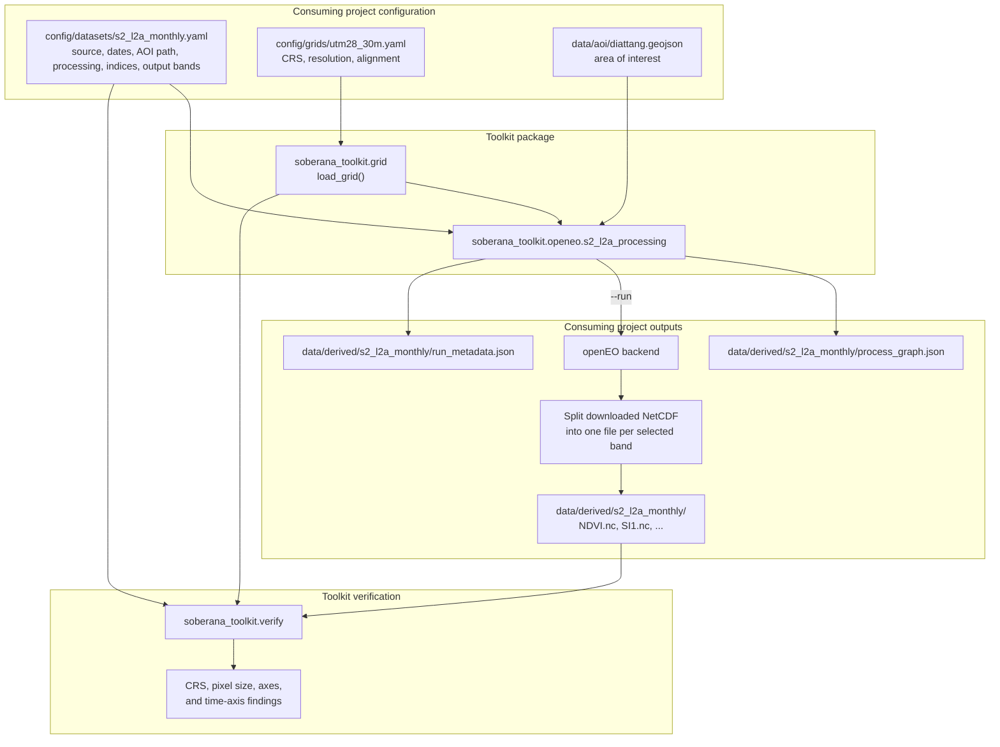
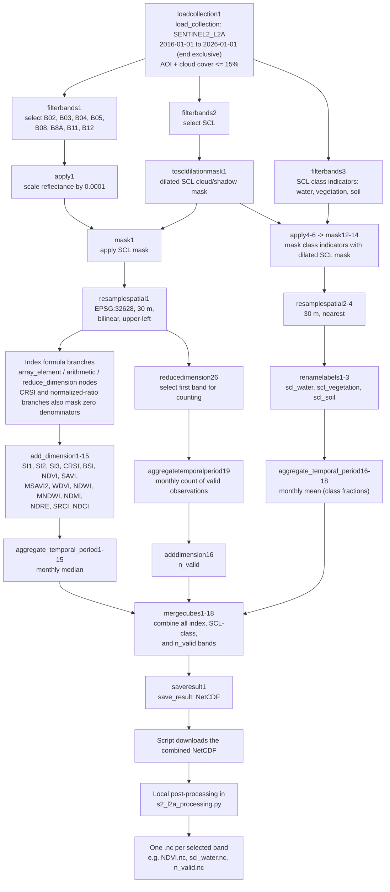
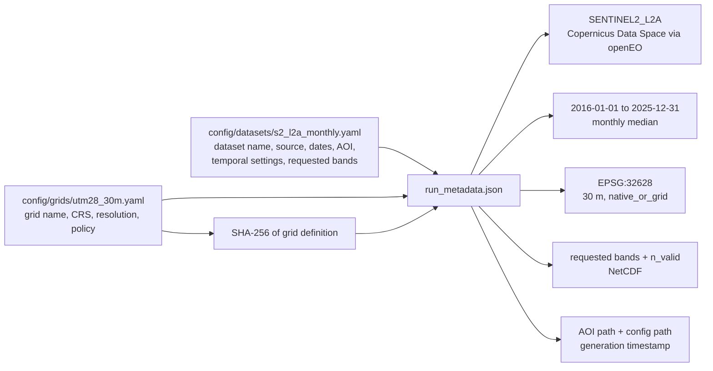

# Configuration and processing flow

These diagrams describe how a consuming project uses the reusable toolkit package. Config,
AOI, and product paths are relative to the consuming project's root; they are not bundled in
this repository.

The dataset config and grid stay in the consuming project and are inputs to both the processing
module and verifier. The dataset config also tells the verifier where to find products. With
NetCDF output, the module downloads the combined openEO result temporarily and writes one `.nc`
file for each selected output band. `process_graph.json` is written when the graph is built; the
NetCDF products require `--run`.

## Generated openEO process graph

This is a readable summary of the actual 112-node graph generated in the consuming project's
`data/derived/s2_l2a_monthly/process_graph.json`. Repeated per-band arithmetic is grouped by
output; the openEO node IDs are retained so the chart can be traced back to that JSON.

The final three boxes are script-side handling after the openEO graph finishes; the splitter
is not an openEO process node. The chart groups the graph's many arithmetic nodes rather than
drawing each individual addition, multiplication, and division.

## `run_metadata.json` provenance

The metadata file is a summary of the inputs and settings used for the graph, not another
processing graph. This chart reflects the S2 example's metadata at
`data/derived/s2_l2a_monthly/run_metadata.json`:

The example metadata snapshot has no `job_id` field.
